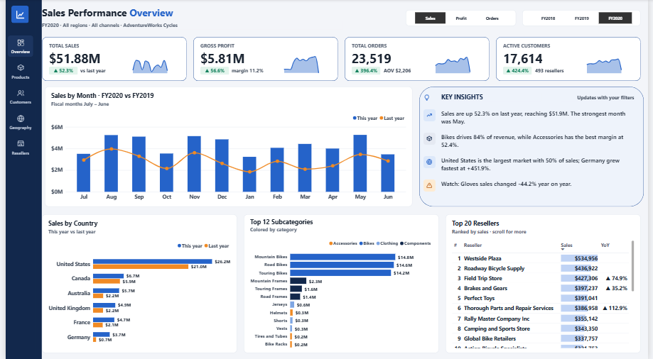

# AdventureWorks Sales Performance Dashboard (Power BI)

An executive sales dashboard that **explains itself**: alongside the KPIs and charts, a *Key Insights* panel writes plain-English findings with DAX and rewrites them whenever the year or metric changes.



> Built on Microsoft's **AdventureWorks** sample data (a fictional bicycle company). Figures below refer to fiscal year 2020 (Jul 2019 – Jun 2020).

---

## Business questions it answers
- How are sales, profit, orders and customers trending against last year?
- Which months, categories and countries drive revenue — and which are slipping?
- Where is margin strongest, and who are the most valuable resellers?

## Highlights
| Feature | How it is built |
|---|---|
| **Auto-generated insights** | Text measures (`Insight 1–4 Text`) compose sentences from ranking and growth measures |
| **One-click metric switch** | Disconnected `Metric Selector` table + `SWITCH` measures with a **dynamic format string** |
| **Fiscal-year time intelligence** | Marked Date table (fiscal year starts 1 July), `SAMEPERIODLASTYEAR`, `TOTALYTD(..., "6/30")` |
| **KPI cards with sparklines and ▲▼ badges** | Measure-driven text and colours layered with area-chart sparklines |
| **Dynamic titles** | Chart titles and the page subtitle follow the selected year, metric, region and channel |
| **Designed before built** | Mockup → pixel grid (1920×1080, 20 px gutters) → custom theme JSON → build |

## Key findings (FY2020 vs FY2019)
- Sales up **52.3%** to **$51.9M**; profit **$5.8M** at an **11.2%** margin.
- **Bikes** generate **84%** of revenue, but **Accessories** carry the best margin (**52.4%**).
- The **United States** is half of all sales; **Germany** grew fastest (**+452%**).
- Orders (+396%) and customers (+424%) jumped as the online channel scaled up with many smaller orders.
- Watch item: **Gloves** sales fell **44%**.

All headline figures were cross-checked against the raw source data outside Power BI.

## Data model
Star schema with `Sales` as the single fact table; every dimension filters one way.

```
            Date (marked, fiscal)
                   │ OrderDateKey (active) · ShipDateKey, DueDateKey (inactive)
Customer ── Sales (fact) ── Product
                   │      │
          SalesTerritory  Reseller
```

- 75 measures organised in display folders: Sales · Customers & Products · Channel · Time Intelligence · Metric Switch · Labels · Insights · Display
- Calculated columns: `Sales[Channel]` (Internet / Reseller), `Sales[Sales Order]`

### Sample measures
```dax
Metric Value =
SWITCH (
    [Selected Metric],
    "Profit", [Profit],
    "Orders", [Total Orders],
    [Total Sales]
)
-- format string expression: IF ( [Selected Metric] = "Orders", "#,0", "$#,0" )

Sales YoY % = DIVIDE ( [Sales YoY], [Sales PY] )   -- format: ▲ 0.0%;▼ 0.0%;0.0%

Top Category Share =
VAR TopCat = [Top Category]
RETURN
    DIVIDE (
        CALCULATE ( [Total Sales], Product[Category] = TopCat ),
        CALCULATE ( [Total Sales], ALL ( Product[Category] ) )
    )
```

## Tools
Power BI Desktop (PBIP project format) · DAX · Power Query (M) · custom report theme (JSON)

## Open it yourself
1. Clone or download this repository.
2. In `AdventureWorks Sales Sample.SemanticModel/definition/tables/*.tmdl`, the source path points to `C:\Users\USER\Downloads\AdventureWorks Sales 3.xlsx`. Change it to wherever you saved `data/AdventureWorks Sales 3.xlsx` (or update it in Power Query after opening).
3. Open `AdventureWorks Sales Sample.pbip` in Power BI Desktop and click **Refresh**.

## About me
**Cecilia Emmanuel** — data analyst who enjoys turning raw data into decisions. Open to **Data Analyst / BI Developer** roles.
[LinkedIn](https://www.linkedin.com/in/cecilia-emmanuel-154b8730a) · [GitHub](https://github.com/emmanuelcecilia-data)
